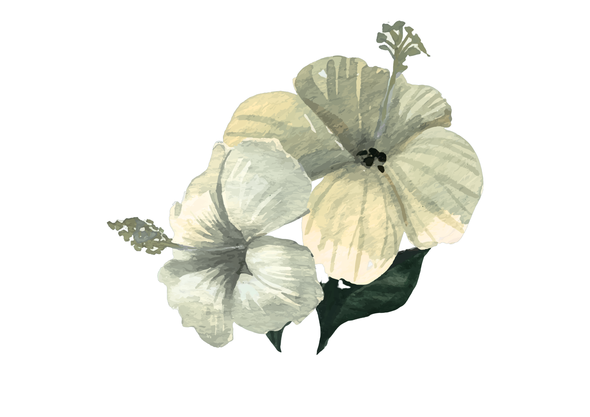
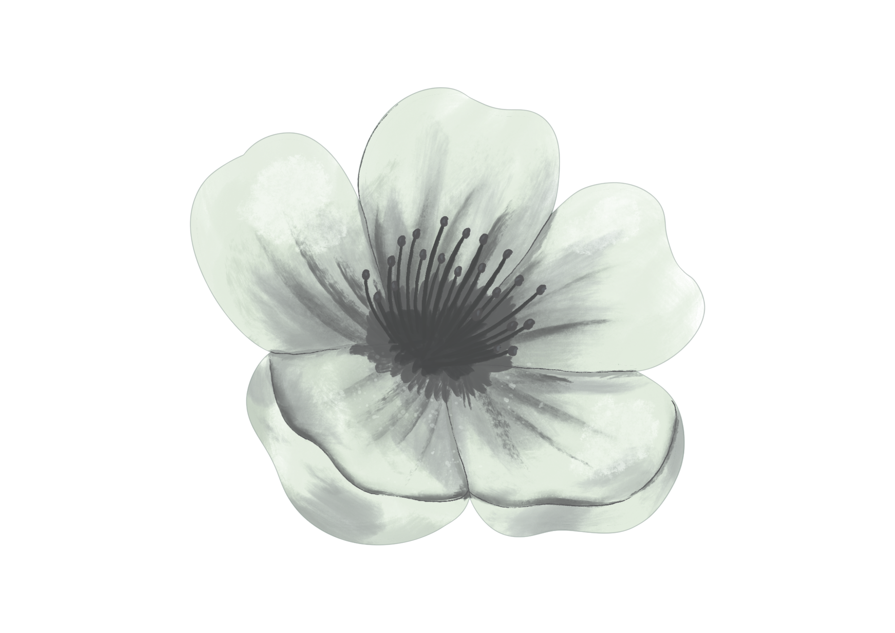

::: {.button-row}
[Request Project Idea](https://forms.gle/tRiNkg8Ut9h8z2sKA){.btn .project-page-btn}
[See Development Teams](https://docs.google.com/spreadsheets/d/1Ig63aIcJ-YsOHum-avcEuz2pCNfOEqSFrUd-Rs_qstg/edit?usp=sharing){.btn .project-page-btn}
[Join a Project](https://docs.google.com/forms/d/e/1FAIpQLSd33Jlt5nIJKRLi93rjcafrrkFRYC24drP9cb_haAkdpVzvgg/viewform?pli=1){.btn .project-page-btn}
:::

::: {.grid}

::: {.g-col-12}
::: {.card-box .project-card}
### CNN Model Analyzing non-coding DNA for Cancer
<mark>Currently Ongoing</mark> <mark>Python</mark> <mark>Machine Learning</mark>

Using Supervised training for a CNN to analyze large DNA datasets, specifically the non-coding DNA sequences, to discover possible patterns that result in Melanoma cancer.\  
\ 
\  
**Author(s):**
*Max Malinsky, Matthew Wade, Neil Dembla, & Max May*

<!-- GitHub logo & Link -->
[ {.btn-logo} GitHub Repo →](http://github.com/Badger-Biodata-Initiative-UW-Madison/cnn-model-dna-analysis-melanoma){.btn .project-page-btn .project-card-btn}

<!-- Corner Flower png -->
{.corner-img-right .corner-img}
:::
:::

::: {.g-col-12}
::: {.card-box .project-card}
### Great Lakes Microplastic Concentration
<mark>Currently Ongoing</mark> <Python> <mark>Statistical Trends</mark> <mark>Mapping</mark> 

Uses current tracking data to map the microplastic concentrations in the Great Lakes Regions to map and output predicted trends from statistical prediction models.
  
  
**Author(s):**
*Ava Auchter, Harini Rajan, Neil Dembla, & Jayden Merrick*

<!-- GitHub logo & Link -->
[ {.btn-logo} GitHub Repo →](https://github.com/Badger-Biodata-Initiative-UW-Madison/lakeshore-preserve-biodiversity-trends){.btn .project-page-btn .project-card-btn}

<!-- Corner Flower png -->
{.corner-img-left .corner-img}
:::
:::

::: {.g-col-12}
::: {.card-box .project-card}
### UW Arboretum Invasive Species Mapping
<mark>Currently Ongoing</mark> <mark>Mapping</mark> <mark>Statistical Trends</mark>

Uses INaturalist data and API to map out the invasive Buckthorn and Garlic Mustard with a spatial distribution model. This can directly act as actionable conservation data.
  
  
**Author(s):**
*Ahmad Khan, Brian Cook, John McCartan, & Soham Sethi*

<!-- GitHub logo & Link -->
[ {.btn-logo} GitHub Repo →](https://github.com/Badger-Biodata-Initiative-UW-Madison/arboretum-invasive-species){.btn .project-page-btn .project-card-btn}

<!-- Corner Flower png -->
{.corner-img-right .corner-img}
:::
:::

::: {.g-col-12}
::: {.card-box .project-card}
### Species Nucleotide Count Comparisons 
<mark>Currently Ongoing</mark> <mark>R</mark>

Counting and plotting the percentages of each nucleotide of differing species using a DNA FASTA file. Uses Chargaff's rules to justify counting two bases. Data can be from Ensembl.
  
  
**Author(s):**
*John Dinjian, Max Buchanan, Glenn Jayne, Aidan Klinefeldt, Selena Papadakis, Angela Chan, & Shivam Kendale*			

<!-- GitHub logo & Link -->
[ {.btn-logo} GitHub Repo →](https://github.com/Badger-Biodata-Initiative-UW-Madison/nucleotide-count){.btn .project-page-btn .project-card-btn}

<!-- Corner Flower png -->
{.corner-img-left .corner-img}
:::
:::

::: {.g-col-12}
::: {.card-box .project-card}
### Comparative Genomics of Disease Resistance (NLR) Genes 
<mark>Currently Ongoing</mark> <mark>R</mark> <mark>Genetics</mark>

Catalog and compare Nucleotide-Binding Leucine-Rich Repeat (NLR) immune receptor genes across wild and domesticated plant relatives. Data can be sources from  NCBI GenBank genome assemblies. 
  
  
**Author(s):**
*Caroline Hammond, Imaya Ambati, Max Hunter, Isaac Schultz, Nishith Shankar, & Harshel Patel*			

<!-- GitHub logo & Link -->
[ {.btn-logo} GitHub Repo →](https://github.com/Badger-Biodata-Initiative-UW-Madison/genomics-disease-resistance){.btn .project-page-btn .project-card-btn}

<!-- Corner Flower png -->
{.corner-img-right .corner-img}
:::
:::

::: {.g-col-12}
::: {.card-box .project-card}
### Multispectral Forest Analytics Web App
<mark>Currently Ongoing</mark> <Python> <mark>Statistical Trends</mark> <mark>Mapping</mark> 

Interactive web map that extracts Google Earth NIR and SWIR data to determine a forest's health level. Algorithms can calculate the forest water stress level and vegetation level and relay the predicted health of a selected region. Further algorithms may calculate possible future trends using the historical Google Earth data.
   
   
**Author(s):**
*Benjamin Panackal, Reese Martinez, Bruce Li, Pari Thakkar, & Ethan Jones*

<!-- GitHub logo & Link -->
[ {.btn-logo} GitHub Repo →](https://github.com/Badger-Biodata-Initiative-UW-Madison/lakeshore-preserve-biodiversity-trends){.btn .project-page-btn .project-card-btn}

<!-- Corner Flower png -->
{.corner-img-left .corner-img}
:::
:::

::: {.g-col-12}
::: {.card-box .project-card}
### Genome Assembly Quality Evaluator
<mark>Currently Ongoing</mark> <mark>Genetics</mark> <mark>Genome Assembly</mark>

An interactive dashboard web app that allows input of standard FASTA files to be evaluated. Quality of assemblies are based on standard metrics such as contiguity metrics (N50, L50), evolutionary completeness (BUSCO scores), and base composition (GC content).

**Author(s):**
*Tian Qiu, Ethan Atkinson-Sherrill, Jiaxin Chen, Siddarth Verma, & Zeke Zhang*	
  
  
<!-- GitHub logo & Link -->
[ {.btn-logo} GitHub Repo →](https://github.com/Badger-Biodata-Initiative-UW-Madison/genome-assembly-quality-evaluator){.btn .project-page-btn .project-card-btn}

<!-- Corner Flower png -->
{.corner-img-right .corner-img}
:::
:::

:::
